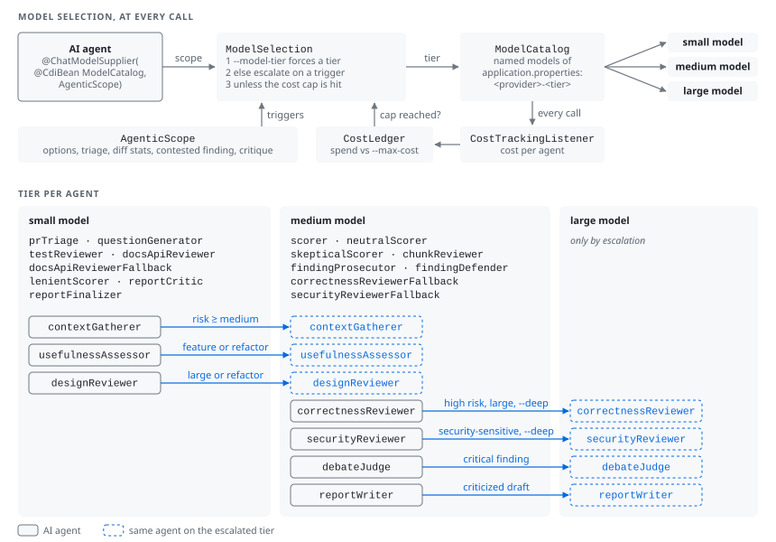
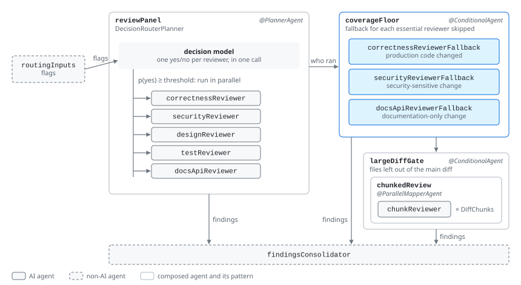
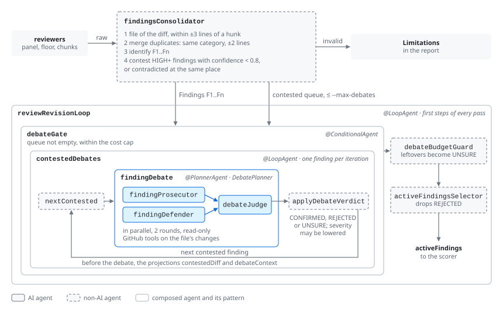
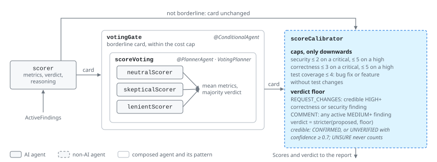
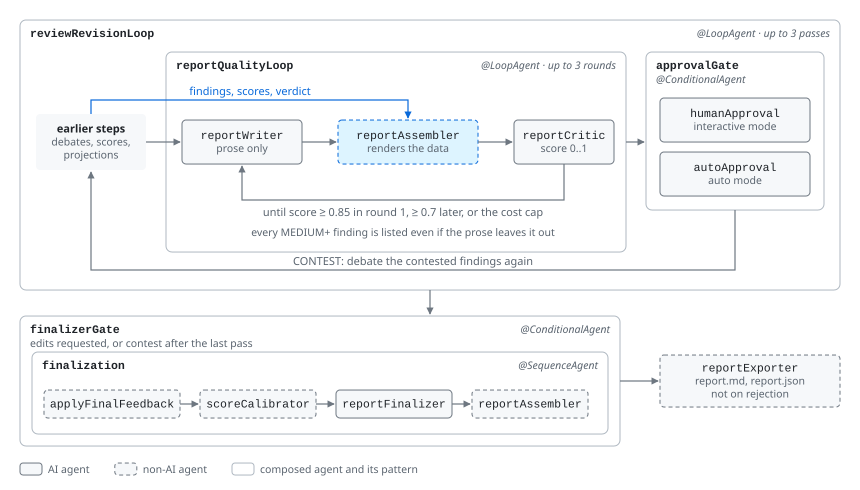
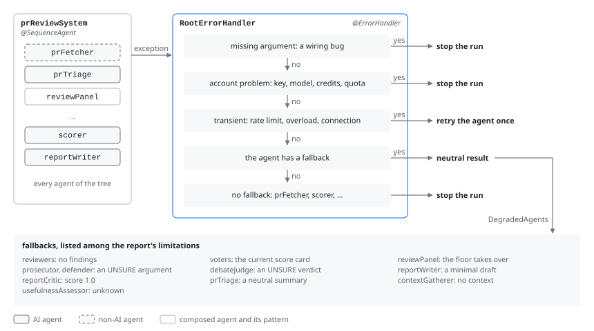

# LangChain4j PR Reviewer

An agentic reviewer for GitHub pull requests, built on `langchain4j-agentic` and running on Quarkus with the
quarkus-langchain4j extensions. Given a pull request URL it produces a report saying what is good, what is wrong and what could be improved, with scores from 0.0 to 10.0 for usefulness, correctness, conciseness, security, test coverage, maintainability, API and documentation, and PR hygiene, an overall score, a confidence and a verdict (`APPROVE`, `COMMENT`, `REQUEST_CHANGES`). It runs from the command line or in a local web interface.

It reads GitHub only through the read-only GitHub MCP server and **never writes to GitHub**: the output is `report.md`, `report.json` and `trace.html` (the agent monitor's trace of the run).

The design and its rationale are in [PLAN.md](PLAN.md); the agent topology is rendered in
[docs/topology.html](docs/topology.html).

## Quick start

Requirements: Java 21+, Maven, Docker (for the GitHub MCP server), a GitHub token, an Anthropic or OpenAI API key, and a decision model for the reviewer router (by default Ollama serving `tev1:0.8b`). [JBang](https://www.jbang.dev) installs the `pr-reviewer` command.

```sh
docker pull ghcr.io/github/github-mcp-server
ollama pull tev1:0.8b                      # or use --decision-model typesafe with TYPESAFE_API_KEY
export ANTHROPIC_API_KEY=...               # and/or OPENAI_API_KEY
export GITHUB_TOKEN=...                    # a read-only fine-grained token; falls back to `gh auth token`

mvn install -DskipTests
jbang app install pr-reviewer@$PWD/jbang-catalog.json   # puts pr-reviewer on the PATH (run `jbang app setup` once)

pr-reviewer review https://github.com/owner/repo/pull/123
pr-reviewer review owner/repo#123 --mode interactive --provider openai
pr-reviewer serve                          # the web interface on http://127.0.0.1:8080
```

Without JBang, `java -jar target/langchain4j-pr-reviewer-1.0.0-SNAPSHOT-runner.jar` takes the same arguments. The report lands in `review-output/<owner>-<repo>-<number>/`.

| Command | What it does |
|---|---|
| `pr-reviewer review <PR> [options]` | Reviews one pull request; progress on stderr, summary on stdout; console interaction in interactive mode |
| `pr-reviewer serve [--port 8080] [--mcp local\|remote]` | Starts the web interface on 127.0.0.1 |
| `pr-reviewer eval run` / `pr-reviewer eval build-set` | Scores the reviewer against the eval set / builds the eval set, see [Eval](#eval) |
| `pr-reviewer completion` | Prints the bash/zsh completion script, see [Shell completion](#shell-completion) |

`review` options (their defaults come from the configuration, see [Configuration](#configuration)):

| Option | Default | Meaning |
|---|---|---|
| `--mode` | `auto` | `auto`, or `interactive`: clarifying questions before the review, approve, edit, contest, drop or reject after it |
| `--provider` | `anthropic` | `anthropic` or `openai`; the tier table below maps the three model sizes to models |
| `--deep` | off | Escalate correctness and security reviews to the large model |
| `--max-cost` | `2.0` | Soft cost cap in USD: past it, voting, debates and escalation are skipped; the review always completes |
| `--decision-model` | `local` | `local` (System One API, `SYSTEM_ONE_BASE_URL`/`SYSTEM_ONE_MODEL_NAME`), `typesafe` (`TYPESAFE_API_KEY`) or `openrouter` (`OPENROUTER_API_KEY`) |
| `--router-threshold` | `0.2` for `local`, `0.5` otherwise | Probability from which the router activates a reviewer |
| `--model-tier` | none | Force `economy`, `standard` or `premium` for every agent |
| `--max-files`, `--max-diff-tokens`, `--max-chunks` | `50`, `60000`, `4` | Size of the reviewed diff, and of the chunked pass over what does not fit |
| `--max-debates` | `3` | Contested findings debated per revision |
| `--mcp` | `local` | GitHub MCP server in Docker, or `remote` (`api.githubcopilot.com`) |
| `--out` | `review-output` | Output directory |
| `--approve-on-eof` | off | In interactive mode, approve when the input ends |
| `-q`, `--quiet` | off | Only the summary, without the progress of every agent |

Usage errors exit with 2, failures with 1.

## Web interface

`pr-reviewer serve` serves a local web interface: a form with the same options (only the providers and decision models whose keys are set are offered), the reviews of the session and the past reports read from the output directory. Reviews run one at a time in submission order; a queued review can be cancelled. The run page follows the review live (every agent with its model, duration and the running cost, over server-sent events). In interactive mode it shows the clarification questions, then the report with a contest and a drop checkbox per finding, notes, and approve, edit, contest or reject; the review waits, and a reload restores the form. Reports are rendered from `report.md`, with the three files downloadable.

It is meant for this machine only: it binds to 127.0.0.1, refuses requests whose `Host` or `Origin` is not local, requires a CSRF token on every form, escapes all report text, serves the trace sandboxed, and uses the server's keys and GitHub token. The pages use Qute templates and htmx, with no JavaScript build.

## Shell completion

```sh
pr-reviewer completion > ~/.local/share/bash-completion/completions/pr-reviewer                    # bash
echo 'autoload -U +X bashcompinit && bashcompinit; source <(pr-reviewer completion)' >> ~/.zshrc   # zsh
```

It completes the commands, the options, their values (`--mode`, `--provider`, `--model-tier`, `--decision-model`, `--mcp`) and paths.

## Configuration

Everything is configured in [`application.properties`](src/main/resources/application.properties) and can be overridden with environment variables or `-D` system properties:

- `reviewer.*` are the defaults of the review options, shared by the CLI and the web form: `REVIEWER_PROVIDER=openai`, `REVIEWER_MAX_COST=1.0`, ...
- The chat models are named configurations, one per provider and size: `anthropic-economy`, `anthropic-standard`, `anthropic-premium`, `openai-economy`, `openai-standard`, `openai-premium`, plus `openai-standard-tools` and `openai-premium-tools` for the agents that call tools. To use `gpt-5-mini` as the medium OpenAI model, for instance: `QUARKUS_LANGCHAIN4J_OPENAI_OPENAI_STANDARD_CHAT_MODEL_MODEL_NAME=gpt-5-mini`.
- The decision models are the named typesafe configurations `local`, `hosted` and `openrouter`; the GitHub MCP servers are `github-local` and `github-remote`.
- Keys: `ANTHROPIC_API_KEY`, `OPENAI_API_KEY`, `TYPESAFE_API_KEY`, `OPENROUTER_API_KEY`, `GITHUB_TOKEN` (else `gh auth token`). The application starts with any subset of keys; a provider without its key is refused, by the CLI with the name of the missing variable.

## Running on OpenAI models

```sh
export OPENAI_API_KEY=...
pr-reviewer review owner/repo#123 --provider openai
```

The same three tiers map to the cheapest OpenAI models of each class (list prices of October 2026, per million tokens):

| Tier | Anthropic | OpenAI | OpenAI input / cached / output |
|---|---|---|---|
| ECONOMY (small model): triage, checklists, critic | Haiku 5.5 | `gpt-5-nano`, effort `low` | $0.05 / $0.005 / $0.40 |
| STANDARD (medium model): reviewers, scoring, writing | Sonnet 5.5 | `gpt-5.6-luna`, effort `medium` | $0.20 / $0.02 / $1.20 |
| PREMIUM (large model): escalations | Opus 5.5 | `gpt-5.1`, effort `high` | $1.25 / $0.125 / $10.00 |

All three are reasoning models: effort goes through `reasoning-effort`, the output budget through `max-completion-tokens` (16K on nano, 64K otherwise, reasoning included), structured outputs use strict JSON schemas, no sampling parameters are sent, and prompt caching is automatic above 1024 tokens. Agents that call tools (the context gatherer and the debaters) get a variant of their tier's model: the chat completions endpoint rejects function tools together with a reasoning effort on `gpt-5.6-luna` and asks for `none`, which `gpt-5.1` also accepts, while `gpt-5-nano` has no `none` level and takes tools at any effort. The reviewer router keeps using the local decision model by default. `OpenAiReviewIT` runs a full review on this configuration when `OPENAI_API_KEY` is set. Real runs on langchain4j PR 6600 (310 changed lines): on 2026-10-14, before the move to Quarkus, `COMMENT` at 7.6/10 for $0.30 with `gpt-5-mini` as the medium model and at 8.2/10 for $0.50 with `gpt-5.6-luna`; on 2026-10-15, on Quarkus, `COMMENT` at 8.2/10 for $0.28. In every run the correctness review escalated to `gpt-5.1` at high effort was most of the cost (up to 38K completion tokens, which is why the medium and large models have a 64K completion budget).

## How it works

The root is a deterministic sequence, built entirely with the declarative API; model judgment lives inside its steps.

```
prReviewSystem (sequence, monitored)
  prFetcher            non-AI   pull request, diff, commits, checks, reviews, linked issue via MCP
  diffPreprocessor     non-AI   parse, classify, render the diff with line numbers, chunk the overflow
  diffText, prOverview, diffChunks   projections of the preprocessor's results
  prTriage             small model   intent, category, size, risk, needs context?
  routingInputs        non-AI   flags for the router
  contextGate          ->  contextGatherer (small or medium model, read-only MCP tools)
  clarificationGate    ->  questionGenerator + humanClarification          [interactive]
  reviewBundleBuilder  non-AI   the pull request bundle every reviewer reads
  usefulnessAssessor   small or medium model, asynchronous
  reviewPanel          DecisionRouterPlanner: correctness, security, design, tests, docs/API in parallel
  coverageFloor        runs the essential reviewers the router skipped
  largeDiffGate        ->  parallel mapper of chunk reviewers over the files that did not fit
  findingsConsolidator non-AI   validate locations, deduplicate, identify F1..Fn, pick contested findings
  reviewRevisionLoop   (up to 3 passes: one, plus up to two contest rounds)
    applyHumanFeedback, debateGate -> contestedDebates -> findingDebate (DebatePlanner), debateBudgetGuard,
    activeFindingsSelector, scorer, votingGate -> scoreVoting (VotingPlanner), scoreCalibrator,
    reportQualityLoop (writer, assembler, critic), approvalGate (human or automatic)
  finalizerGate        ->  applyFinalFeedback, scoreCalibrator, reportFinalizer, reportAssembler
  reportExporter       non-AI   report.md, report.json
```

Quarkus builds this system from its annotations and validates it at build time: every key an agent reads must be
the output of some agent, so a few small *projection* agents (`diffText`, `prOverview`, `diffChunks`,
`contestedDiff`, `debateContext`, `verdict`, `verdictReasoning`, `limitations`) declare values their producers wrote
into the scope.

- **Models.** Each agent picks its tier from the scope through `@ChatModelSupplier`, which Quarkus calls with the model catalog injected and the `AgenticScope`: a small model for triage, checklists and the critic; a medium model for code judgment, scoring and writing; a large model only when the scope shows evidence (high risk, large change, security-sensitive code, `--deep`, a critical contested finding, a rewritten report). The models are named configurations, and the tier table above maps the three sizes to concrete models for each provider. Reasoning is left to the model, reasoning blocks are passed back unchanged in tool loops when the provider requires it, no sampling parameters are sent, reasoning effort grows with the tier on OpenAI (`low`, `medium`, `high`; the Anthropic models run at their default effort), and the output budget, reasoning included, is 16K tokens for the small model and 32K to 64K for the others depending on the provider. Prompt caching covers the short shared system prompts and the tool definitions; the review bundle itself is sent by each reviewer, since it lives in the user message. Agents keep no conversation memory: each invocation starts afresh. Security sensitivity is detected from path names of security components, from dangerous calls (SQL statements, process execution, deserialization, XML parsers, reflection, cryptography), from hard-coded secrets and from dependency changes in build files.

  

- **Reviewer routing.** A decision model answers one yes/no question per reviewer in a single call; every reviewer at or above the threshold runs. The router input is a compact set of flags (production code changed, security-sensitive code, public API, documentation only, ...), and each reviewer description states the flags it needs. A deterministic **coverage floor** then guarantees that production code gets a correctness review, security-sensitive code a security review and documentation-only changes a documentation review, even when the router skipped them.

  

- **Findings.** Every finding must point at a file of the diff and a line near a changed hunk, which removes hallucinated locations and anything smuggled in through the pull request text. High-severity findings with low
  confidence, or contradicted by another reviewer, are debated (prosecutor and defender with read-only tools on the changes of the file concerned, judge last); the judge can confirm, reject or downgrade them. A finding a debate could not settle stays in the report but no longer drives the verdict.

  

- **Scores and verdict.** The model proposes scores and a verdict with reasoning; deterministic rules only cap scores (for example a credible critical security finding caps security at 2.0) and raise the verdict to the floor the findings require. Three scorers vote only when the draft is borderline.

  

- **Report.** The writer produces the prose only; findings, scores and verdict are rendered from the data, so every significant finding is listed even if the writer leaves it out, and no finding can be invented.

  

- **Failures.** One error handler covers the whole tree: rate limits and connection failures are retried once, a
  failing reviewer, voter, debater or the router is replaced by a neutral fallback and disclosed in the report's
  limitations; failures that leave no review (fetching, scoring) and account problems (invalid key, no credits,
  unknown model) stop the run at once.

  

### Reviewer routing measurements

Five synthetic changes (refactoring, SQL injection fix, README change, public API feature, dependency bump), 25
reviewer decisions, with the flag-based descriptions now in use:

| Decision model | Correct decisions | Notes |
|---|---|---|
| Hosted decision model | 25 of 25 at threshold 0.5 | Clear separation: 0.78–0.96 against 0.02–0.05 |
| Small local decision model (0.8B parameters) | 22 of 25 at the best threshold (0.16); 17 of 25 at 0.5 | Hence the default threshold of 0.2 for `LOCAL`; the coverage floor makes up for the rest |

With the earlier topic-style descriptions the local model got 13 of 25. `ReviewRouterIT` and `HostedReviewRouterIT` replay three of these cases through the whole system. For better routing use a hosted decision model (`--decision-model typesafe` or `openrouter`).

## Interactive mode

Before the review, up to three generated questions are asked, plus an open question about focus areas; the answers
reach every reviewer. After the report is written, at the console:

```
approve | edit <notes> | contest F3 F7 [notes] | drop F2 [notes] | reject [notes]
```

`contest` sends the findings to a debate (with your notes) and runs scoring and writing again; `drop` removes findings; both can be combined. Two contest rounds are possible; a contest after the last round is applied without a debate. Past the cost cap, contesting is refused and `drop` or `edit` are offered instead. The web interface asks the same questions and offers the same decisions as forms.

## Testing

```sh
mvn verify          # unit, orchestration, CLI and web tests: no model, no network
mvn verify -Pit     # integration tests, each enabled only when its service is available
```

- Orchestration tests (`@QuarkusTest`) run the agentic system Quarkus builds, with every model answered by a scripted model that knows which agent is calling, a fake decision model and GitHub from recorded MCP responses: routing and coverage floor, interactive contest rounds, debates, voting, cost cap, chunked review, failure handling, rejection, edits.
- A scripted-model test runs every real prompt template and structured output through the whole system, and checks the escalations, the cost attribution and the live progress events.
- Command line tests (`@QuarkusMainTest`) and web tests (RestAssured): help, completion, usage errors, a review end to end; the queue, server-sent events, an interactive round trip, cancellation, escaping, and the refusal of foreign hosts, origins, missing CSRF tokens and path traversal.
- Integration tests: the GitHub MCP server in Docker, the router on local Ollama and on hosted TypeSafe, full reviews with the real OpenAI or Anthropic models, and the recognition of account errors (invalid key, unknown model) by the error handler.

## Eval

```sh
pr-reviewer eval build-set                   # labels closed PRs of public Java repositories from their outcomes
pr-reviewer eval run --limit 1 --runs 1      # check the cost of one case first
pr-reviewer eval run --runs 3                # verdict agreement, must-find recall, unmatched findings, stability, cost
```

Labels come from what happened to each pull request: `REQUEST_CHANGES` when changes were requested or it was closed after review, `COMMENT` when it was merged after addressed review comments, `APPROVE` otherwise; review comments followed by a commit are must-find items. Outcomes reflect maintainers' priorities as well as code quality, so treat the labels as a floor rather than ground truth.

## Safety

The GitHub MCP server runs read-only (`GITHUB_READ_ONLY=1`) with only the repos, pull requests and issues toolsets; AI agents get five read tools; use a read-only fine-grained token. Every prompt states that the pull request content is untrusted data, and wraps it in delimiters; the content itself is always in the user message, never in a system prompt. Findings whose location is not in the diff are discarded, which also neutralizes anything smuggled in through the pull request text. The web interface's own protections are described [above](#web-interface).
